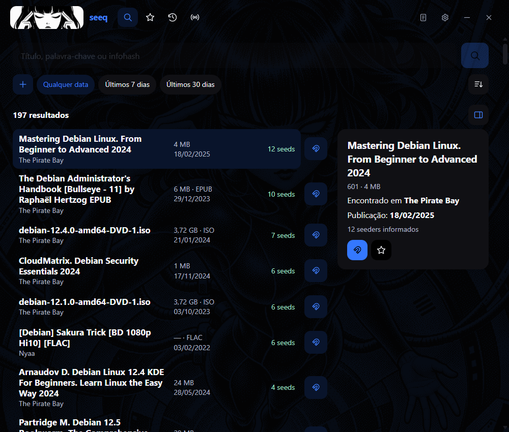

# seeq

Busca de torrents em fontes públicas — aplicativo nativo para Windows. O seeq **não é um cliente BitTorrent**: ele encontra metadados e links (magnet / `.torrent`) em dezenas de fontes e abre o link no cliente que você já usa.



## Recursos

- **15 fontes públicas integradas**: Internet Archive, Debian, The Pirate Bay, Nyaa, YTS, EZTV, SubsPlease, FitGirl, EXT.to, 1337x, FOSS Torrents, Academic Torrents, Blender Video, Ubuntu e Fedora.
- **Busca inteligente em linguagem natural** — filtros escritos junto com o termo, viram etiquetas removíveis:
  `linux iso últimos 7 dias até 3 GB`
- **Facetas e filtros avançados**: fonte, categoria, idioma, qualidade, formato, tipo de link, período, ano, tamanho e seeders.
- **Favoritos e histórico** com remoção por item e limpar tudo (com confirmação).
- **6 idiomas**: português (BR), inglês, espanhol, russo, japonês e chinês simplificado.
- **Aparência personalizável**: temas Sistema / Papel / Grafite / Meia-noite / AMOLED, cor de destaque e fundo ilustrado com modo de mistura e intensidade.
- **Fontes privadas via Jackett local** (RuTracker, CGPeers) e **plugins de fonte em Python**.
- **Servidor MCP read-only** para agentes de IA (Hermes e outros).
- Portátil: o executável standalone embute Python e o WebView2 — não instala nada.

## Download

Windows 10/11 x64. Baixe `seeq-Standalone-x64.exe` na aba [Releases](https://github.com/renmatsi/seeq/releases), execute e pronto — na primeira abertura ele extrai o runtime em `%LOCALAPPDATA%\seeq`.

Seus dados (configuração, histórico, favoritos) ficam em `%APPDATA%\torrentFindr`.

## Compilar

Requisitos: SDK .NET 10, Python 3.10+, ZIP embeddable oficial do Python (x64) e WebView2 Fixed Version (x64, extraído do CAB).

```powershell
# 1. Navegador integrado (fontes EXT.to / 1337x)
dotnet publish embedded-browser/TorrentFindr.Browser.csproj -c Release -r win-x64 --self-contained -o browser -p:PublishSingleFile=true -p:IncludeNativeLibrariesForSelfExtract=true -p:EnableCompressionInSingleFile=true

# 2. Payload (Python + WebView2 + app)
python desktop/pack_payload.py C:/pacotes/python-x64.zip C:/pacotes/WebView2-extraido build/payload.zip

# 3. Executável standalone
$payload = (Resolve-Path build/payload.zip).Path
dotnet publish desktop/TorrentFindr.Desktop.csproj -c Release -r win-x64 --self-contained -o build/standalone -p:PublishSingleFile=true -p:IncludeNativeLibrariesForSelfExtract=true -p:DebugType=None "-p:PortablePayload=$payload"

# Versão em pasta (sem payload embutido; requer Python instalado)
dotnet publish desktop/TorrentFindr.Desktop.csproj -c Release -r win-x64 --self-contained -o desktop-app
# executar: Iniciar.bat
```

## MCP

O seeq expõe `list_sources` e `search` como servidor MCP stdio (read-only, fontes públicas diretas):

```yaml
mcp_servers:
  seeq:
    command: python
    args: [-B, C:/caminho/para/seeq/seeq_mcp.py]
```

## Arquitetura

| Camada | Implementação |
|---|---|
| Shell | .NET 10 WinForms + WebView2 (`desktop/`) |
| Interface | HTML/CSS/JS puro, 6 idiomas (`interface/`) |
| Motor | Python 3.13, busca concorrente por fonte (`desktop_backend.py`, `core.py`, `extra_sources.py`, `catalog_sources.py`) |
| Filtros | Linguagem natural + facetas (`search_filters.py`) |
| Fontes protegidas | Navegador WebView2 dedicado (`embedded-browser/`) |
| Agentes | Servidor MCP stdio (`seeq_mcp.py`) |

## Créditos

Desenvolvido por **[Renan Matos](https://renmatsi.github.io/)**.

Inspirado no conceito do Torlink (MIT, © 2026 bairon.dev), implementado de forma independente.
